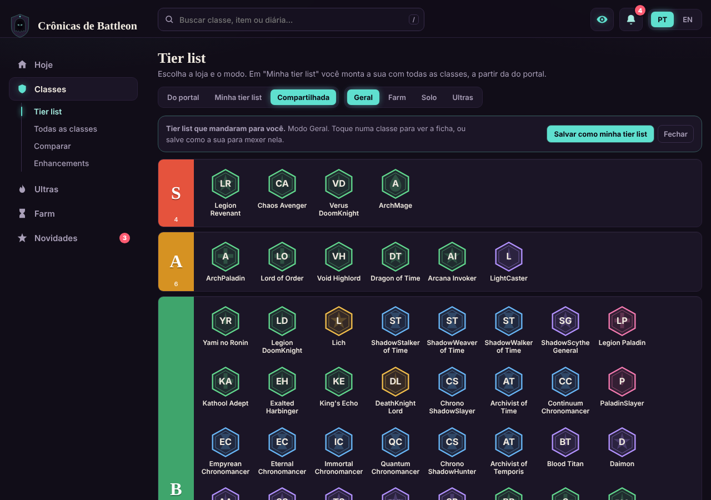
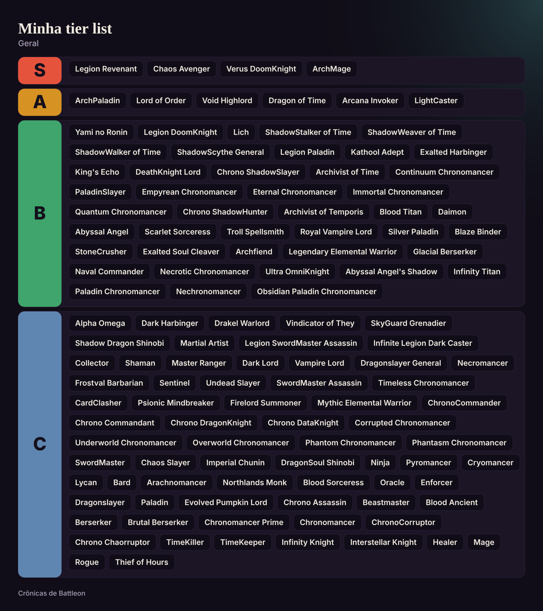
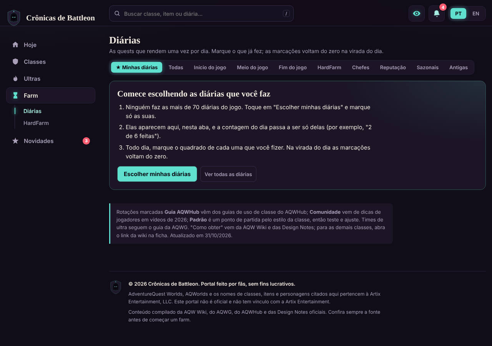
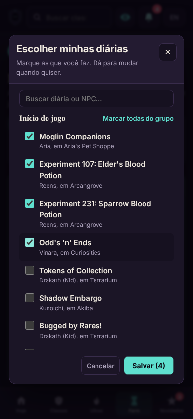

# Crônicas de Battleon

Guia de AdventureQuest Worlds feito por fãs, em português e inglês: qual classe usar, o que farmar hoje, como montar time de ultra e o que entrou no jogo em cada atualização.

Versão atual: **2.7.0**. Projeto não oficial; AdventureQuest Worlds e as marcas relacionadas pertencem à Artix Entertainment, LLC.

**Abrir o portal:** https://david-nascimento.github.io/cronicas-de-battleon/ (no celular, dá para instalar como app pelo menu do navegador).


## O que tem no portal

O portal tem 5 destinos, e cada um guarda suas abas: **Hoje**, **Classes**, **Ultras**, **Farm** e **Novidades**. A busca do topo acha classes, itens novos, diárias e cards de HardFarm de qualquer lugar (atalho: tecla `/`). Ela também leva às partes do portal: quem digita "tier list", "diárias", "enh" ou "ultra" vê **Ir para** e cai direto na aba. Ela ignora acento, maiúscula, espaço e hífen ("paladin slayer" acha PaladinSlayer).

### Hoje

Quatro atalhos pelo que a pessoa quer fazer (qual classe usar, o que saiu de novo, diárias de hoje, ultras da semana), o resumo da última atualização com os joins do evento, o reset semanal, as notícias de classes e o top 5 de cada modo.

### Itens novos

Tudo que entrou no jogo em cada atualização, com filtro por tipo, busca, marcas de AC e Legend, de onde sai cada item (quando a fonte diz), os mapas com `/join` para copiar e as lojas novas. Cada nome abre a página do item no AQW Wiki. Quando sai uma atualização, o sino, o banner da página Hoje e o menu avisam.


### Tier list e Minha tier list

A tier list do portal separa por loja (Free, Member, ACS, HeroMart, Calendário) e por modo (Geral, Farm, Solo, Ultras). Em **Minha tier list**, cada pessoa monta a sua com todas as classes juntas, a partir da do portal: arraste a classe para um tier, ou toque nela e escolha S, A, B, C ou Sem tier. As classes ainda sem tier ficam embaixo, com uma busca só para elas. Fica salva no navegador, uma por modo, e dá para voltar à do portal, começar do zero ou compartilhar:

- **Baixar imagem:** um PNG com os tiers e os nomes, pronto para postar (no celular abre o menu de compartilhar).
- **Copiar link:** a lista vai dentro do endereço. Quem abre vê a aba **Compartilhada**, pode abrir a ficha de cada classe e tocar em **Salvar como minha tier list** para mexer nela.
- **Copiar texto:** os tiers em texto simples.


| Tier list que chegou por link | Imagem gerada |
|---|---|
|  |  |

### Diárias

107 quests diárias conferidas no AQW Wiki, cada uma com o `/join` (quando confirmado), quem dá a quest, o que é preciso, a recompensa e para que serve. Grupos: início, meio e fim do jogo, HardFarm, chefes (incluindo os 6 Daily Exercises da Legion), reputação, sazonais e antigas. Marque o que já fez; as marcações voltam do zero na virada do dia, no horário que você escolher. Na primeira visita, a aba **★ Minhas diárias** explica em 3 passos o que fazer e abre o seletor **Escolher minhas diárias**: uma lista com caixas de marcar, busca e "marcar todas do grupo". A contagem passa a ser só das escolhidas ("3 de 12"), e dá para mudar depois em **Editar minhas diárias** ou no botão **☆ Adicionar às minhas** de cada diária. Dá para ligar um lembrete 1 hora antes da virada, que aparece enquanto o portal está aberto. As que você não faz podem ser ocultadas.

| Primeira visita | Escolher minhas diárias (celular) |
|---|---|
|  |  |


Na aba **Sazonais** aparece o evento que está no ar, com a data de fim e os mapas, e o card **Neste mês: Event Hub**: o `/join eventhub` (o mapa que reúne os eventos do mês) e o que está no ar com data para acabar (recompensas de evento, coleções, o set sazonal do mês), com as fontes. A página Hoje mostra o mesmo em versão curta, e a busca acha com "event hub". Cada item some sozinho depois da data de fim.


### HardFarm

99 farms longos (classes, armas e armaduras, materiais, reputação, diárias e sazonais), com o esforço estimado, onde começar (`/join`), o que é preciso em cada etapa e a fonte. Em 81 etapas aparece **Aceite**: a quest que precisa pegar, quem dá e o `/join`. Em 242 das 288 etapas há **Onde conseguir cada item**: o monstro, a quest ou a loja de cada material, com o `/join` para copiar (fontes: guias do AQWG e AQW Wiki; os dados ficam em `tools/where/` e entram no `hardfarm.json` com `python3 tools/where/apply.py`; as quests ficam em `tools/where/quests.py`). Marque as etapas que já concluiu: a barra mostra o progresso, fica salva no navegador e o filtro **Em andamento** junta os farms que você começou.


### Classes novas

Quando uma atualização traz uma classe que o portal ainda não analisou, ela entra sozinha, a partir dos Itens novos: aparece na loja **Novas** da tier list (numa faixa "?", sem tier), na Minha tier list (em Sem tier), em Todas as classes e na busca, com a marca de nova e um aviso na ficha. Itens que são cópia de uma classe que já existe (como "PaladinSlayer (2)") ficam ligados a ela em `class-aliases.json`. Nos Itens novos, cada classe tem o botão **Ver ficha**. Quando a classe ganha tier e guia em `classes.json`, ela sai de "Novas" sozinha.

### Ficha de classe

Cada classe abre uma ficha com como obter, consumíveis, as melhores combinações de enhancement, sequências de skills e, na seção **No portal**, o farm dela no HardFarm, as diárias que ajudam, as notícias e a atualização em que saiu.

### Ultras

Agenda de ultras (semanais, sazonais e outras), times de 4 classes com a função de cada uma e o que fazer na luta, itens de dano e consumíveis, e o montador de time a partir das classes que você tem.


### Visual Hollowborn, tema claro e celular

O visual segue o tema Hollowborn do AQW: fundo violeta escuro, texto cor de osso e um brilho que segue a **cor dos olhos** escolhida no botão de olho do topo (Espectral, Vazio, Sangue, Brasa ou Osso), como o equipamento Hollowborn. O ícone da aba muda junto. O tema claro acompanha o sistema, e no celular o menu vai para baixo.

| Cor dos olhos "Vazio" | Tema claro |
|---|---|
|  |  |

| Celular: Hoje | Celular: Diárias |
|---|---|
|  |  |

As capturas foram feitas num ambiente sem acesso ao Google Fonts; no navegador os títulos aparecem na fonte Texturina.

## Como usar

- **Só abrir:** `dist/index.html` já está compilado. Dois cliques e funciona, sem servidor.
- **Mexer no código:** instale uma vez com `npm install`, depois:
  - `npm run dev`: recompila ao salvar e serve em http://localhost:5173 (grava em `.dev/`, não mexe no `dist/`)
  - `npm run build`: gera `dist/` otimizado
  - `npm run typecheck`: confere os tipos com o TypeScript (`tsc`)
  - `npm test`: abre o portal num Chromium e confere navegação, itens novos, tier list, diárias, HardFarm, idioma e celular (precisa de `npx playwright install chromium` uma vez). O GitHub roda build, tipos e testes a cada mudança na `main` e, se passar, publica o `dist/` no GitHub Pages (`.github/workflows/ci.yml`, com Settings > Pages > Source: **GitHub Actions**).
  - `bash tools/publish-pages.sh`: publica o `dist/` no branch `gh-pages`, para o Pages em Settings > Pages > **Deploy from a branch**, `gh-pages`, `/ (root)`. A tarefa agendada também faz isso a cada atualização de dados.

### Manter a pasta do computador atualizada

A tarefa agendada atualiza o GitHub; a sua pasta só recebe com `git pull`. O `atualizar.bat` faz isso: dois cliques, ou deixe o Windows rodar sozinho sábado e segunda às 9h30 (meia hora depois da tarefa), colando uma vez no terminal:

```
schtasks /Create /TN "Cronicas de Battleon - atualizar" /TR "E:\Projetos\cronicas-de-battleon\atualizar.bat" /SC WEEKLY /D SAT,MON /ST 09:30
```

O resultado de cada vez fica em `atualizar.log`. O `npm run dev` grava em `.dev/` (fora do git), então ele pode ficar rodando sem travar o pull; o `dist/` é só a versão oficial, gerada por `npm run build`.

### App instalável e offline

`public/` tem o `manifest.webmanifest` e os ícones; o build copia tudo para `dist/` e gera `dist/sw.js` a partir de `tools/sw.template.js`, com a versão tirada do hash do build. Servido por http(s) (GitHub Pages, `npm run dev`), o navegador oferece "Instalar app" e o portal abre sem internet com a última versão vista. Abrindo `dist/index.html` direto do disco, o service worker não liga (limite do navegador), mas o resto funciona.

## Onde fica cada coisa

```
index.html            estrutura da página (menus, seções, diálogos)
src/                  TypeScript; tipos dos dados e do estado em types.ts
  main.ts             ponto de entrada: carrega tudo e inicia a página
  config.ts           categorias, modos, destinos e abas (SECS, SUBS, SEC), ícones, cores dos olhos
  state.ts            estado salvo no navegador, idioma (L, T) e estado da interface (ui)
  render-all.ts       monta cada aba só quando ela aparece; redesenha ao trocar de idioma
  events.ts           cliques globais (abrir ficha, comparar, navegação...)
  data/               conteúdo em JSON (veja "Atualizar conteúdo")
    i18n/             textos da interface (ui.json) e traduções (en.json)
    index.ts          junta os JSON e monta a lista final de classes
  lib/util.ts         funções pequenas (escape de HTML, busca sem acento, brasão da classe, link do wiki)
  components/         pedaços de interface reutilizados
  views/              uma por aba: home, tiers (e Minha tier list), cards, compare, agenda, teams, builder,
                      enhancements, farms (HardFarm), dailies, releases (itens novos), nav
  features/           notícias, alertas e notificações, avisos na tela, busca global, cor dos olhos
  styles/             CSS por área; tokens.css tem as cores e main.css define a ordem (a ordem importa)
public/               manifest e ícones do app instalável
tools/                build com esbuild e o modelo do service worker
docs/screenshots/     as capturas deste README
legacy/               a versão anterior (index.html + css + js), para comparar
```

## Atualizar conteúdo

Edite os arquivos em `src/data/` e rode `npm run build`:

| Arquivo | Onde aparece |
|---|---|
| `releases.json` | Itens novos, card da última atualização e evento sazonal nas Diárias |
| `month.json` | Neste mês: Event Hub e o que está no ar com data de fim (`list`: `t`, `x`, `j`, `from`, `until`, `src`) |
| `dailies.json` | Diárias |
| `hardfarm.json` | HardFarm |
| `news.json` | Notícias de classes e o sino |
| `classes.json`, `class-types.json`, `obtain.json` | Tier list, fichas das classes |
| `class-aliases.json` | Itens de classe que são cópia de uma classe existente (nome do item → classe) |
| `ultra-teams.json`, `ultra-schedule.json`, `ultra-items.json` | Ultras |
| `enhancements.json` | Enhancements |

### Atualização automática

Uma tarefa agendada roda todo **sábado e segunda às 8h53** (horário de Fortaleza) na branch `main`. Ela confere o AQW Wiki e as Design Notes, completa `releases.json`, `news.json`, `dailies.json` e `month.json`, liga as classes novas (`classes.json` quando há informação para o guia, `class-aliases.json` para cópias), gera o build, testa o site num navegador, só faz commit se algo mudou e atualiza o site no branch `gh-pages`.

### Formato de `releases.json`

Uma entrada por atualização, a mais recente primeiro (`list[0]`). Campos: `id` e `from`/`to` (datas AAAA-MM-DD), `t` e `x` (título e resumo em pt/en; o que vem antes de ":" no título vira o nome do evento), `until` (fim do evento, opcional), `maps` (`j` = join conferido, `n` = nome, `w` = o que tem lá), `shops`, `srcs` (de onde saem os itens: chave → texto pt/en e `j` opcional), `src` (links das fontes) e `items` por tipo (`class`, `armor`, `helm`, `cape`, `weapon`, `pet`, `ground`, `house`, `misc`). Cada item é `[nome, marcas, fonte?, subtipo?]`: marcas `a` (tag de AC) e/ou `l` (Legend); fonte é uma chave de `srcs`; subtipo só para armas (`dagger`, `sword`, `polearm`...). Guarde as 4 atualizações mais recentes.

### Formato de `dailies.json`

Cada diária: `id`, `g` (grupo: `start`, `mid`, `end`, `hf`, `boss`, `rep`, `season`, `old`), `n` (nome; `ne` para o nome em inglês, se mudar), `who` (quem dá e onde), `req`, `rw` e `for` (pt/en), `j` (joins conferidos), `mem` (`m` member, `l` Legend), `hf` (nome do card de HardFarm ligado) e `src`/`sn` (fonte). Os grupos `rep`, `season` e `old` não entram na contagem do dia.

## Fontes

O conteúdo vem do [AQW Wiki](https://aqwwiki.wikidot.com/), das [Design Notes](https://www.aq.com/gamedesignnotes/) oficiais, do [AQWG](https://sites.google.com/view/aqwg-net/) e do [AQWHub](https://www.aqwhub.com/). Joins que não deu para confirmar aparecem marcados como não confirmados.
